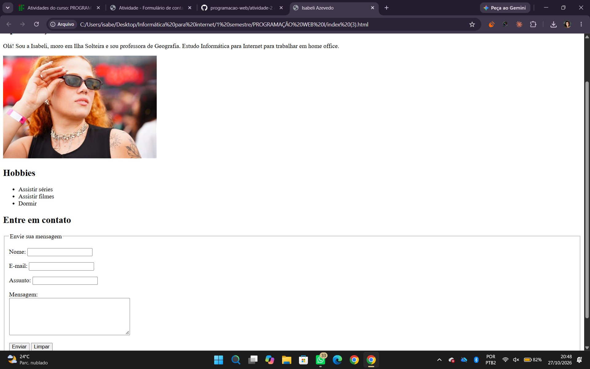

# Atividade 2 — Página pessoal e formulário de contato

Página pessoal de Isabeli Azevedo, desenvolvida na disciplina Programação Web I.

A seção **Entre em contato** contém campos de nome, e-mail, assunto e mensagem, com campos obrigatórios, rótulos associados, agrupamento com `fieldset` e `legend` e botões **Enviar** e **Limpar**.

## Captura da página

Página aberta no navegador, mostrando o formulário implementado:

